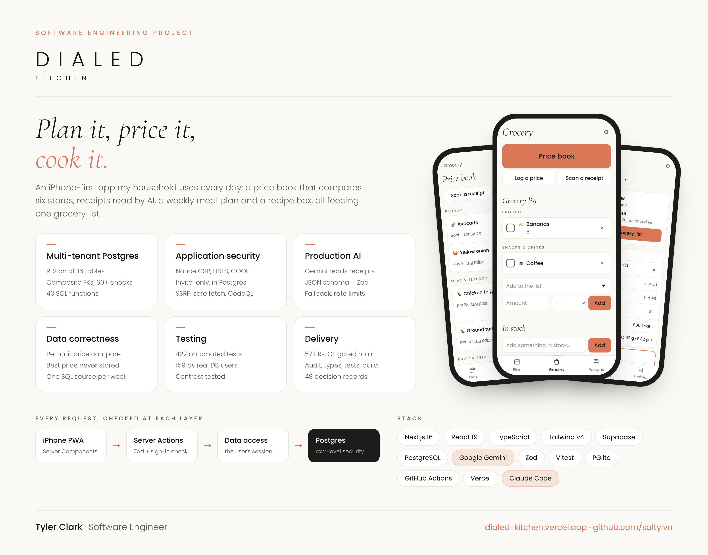
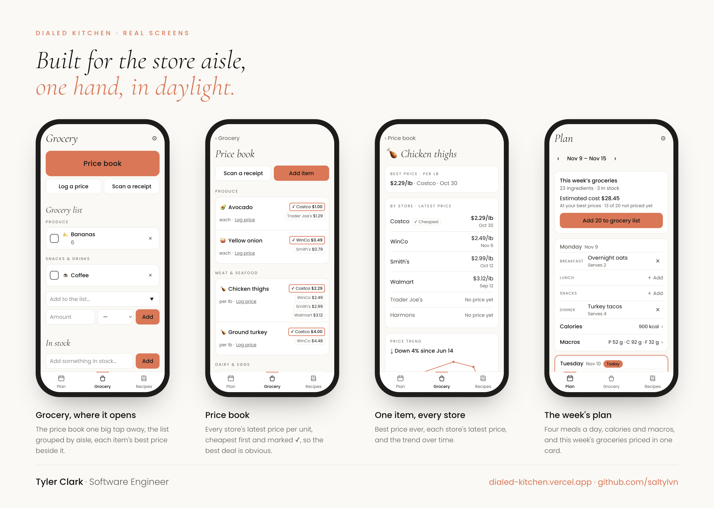

# Dialed Kitchen

[](https://github.com/saltylvn/dialed-kitchen/actions/workflows/ci.yml)
[](https://github.com/saltylvn/dialed-kitchen/security/code-scanning)


**Plan it, price it, cook it.** An iPhone-first web app (installable PWA) that my household uses every day to shop, compare grocery prices across stores, plan the week's meals and cook from saved recipes. AI reads receipts and recipe photos, behind strict guard rails.

> **Live:** [dialed-kitchen.vercel.app](https://dialed-kitchen.vercel.app) · **Status:** in daily use, all roadmap milestones shipped
>
> **Try it:** open the app and tap **Try the demo**. It's a shared demo kitchen with sample recipes, a planned week and price history, reset daily, with no sign-up needed ([how it works](docs/decisions/0026-demo-account.md)).



## For reviewers: a five-minute tour

| Look at                                                                                                         | What it shows                                                                                                           |
| --------------------------------------------------------------------------------------------------------------- | ----------------------------------------------------------------------------------------------------------------------- |
| [`supabase/migrations/…_households.sql`](supabase/migrations/20261023000000_households.sql)                     | Multi-tenant data model: row-level security, composite foreign keys, column grants, invite tokens stored only as hashes |
| [`supabase/tests/`](supabase/tests/)                                                                            | 159 tests against real Postgres (PGlite) that sign in as different users and try to read or forge each other's data     |
| [`lib/server/safeFetch.ts`](lib/server/safeFetch.ts)                                                            | SSRF-safe fetching of user-supplied links, with the address check inside the socket's own DNS lookup (no DNS rebinding) |
| [`supabase/migrations/…_waitlist_and_invites.sql`](supabase/migrations/20261110000000_waitlist_and_invites.sql) | Invite-only sign-up enforced by a Postgres trigger on `auth.users`, so no app bug can create an account                 |
| [`lib/ai/receiptFromImage.ts`](lib/ai/receiptFromImage.ts)                                                      | Production AI: a JSON schema for Gemini, Zod validation of every reply, and prompt-injection-aware instructions         |
| [`lib/pricing.ts`](lib/pricing.ts), [`lib/units.ts`](lib/units.ts)                                              | Pure, unit-tested money and unit math: prices compared per gram, millilitre or item, never guessed across kinds         |
| [`docs/decisions/`](docs/decisions/)                                                                            | 48 architecture decision records: context, decision, alternatives and consequences                                      |

## What it does

**Grocery** (where the app opens)

- **Price book:** every item, with each store's latest price shown as a chip, cheapest first and marked ✓. Prices are compared **per unit**, so a 5 lb bag and a 2 lb bag compare fairly. Each item also has its best price ever, full history and a trend chart.
- **Scan a receipt:** take up to three photos of a receipt. AI reads each line and matches it to your price book (remembering each store's abbreviations), and you review everything before one tap saves a whole trip's prices.
- **Log a price** with swipe wheels for the store, price and package size, and see "🎉 New best price!" or how far above your best it is.
- **Grocery list** grouped by store section, with the best price beside each item. Tick something and it moves **In stock**, the kitchen inventory, with Undo.

**Plan**

- A Monday-to-Sunday week with four spots a day: Breakfast, Lunch, Snacks, Dinner. Each spot offers that meal's recipes, picked by swipe wheel.
- **Calories** and **Macros** per person for each day.
- **This week's groceries:** every ingredient summed across the week and scaled to the servings planned, skipping what's In stock or already listed, with an estimated cost at your best prices. One tap adds it all to the list.

**Recipes**

- Grouped by meal, with favorites and "regulars" (recipes you plan often) first.
- Add a recipe from a **website link** (read from the page's schema.org data, no AI), from **photos** of a cookbook or recipe card (read by Gemini), or by typing.
- Cook from your phone with the screen kept awake. Tick ingredients In stock and add what's missing to the list. **Estimate with AI** fills in calories and macros.

**Sharing and access**

- **Partner sharing:** a married couple shares one kitchen through an invite-only household of at most two people, enforced by database constraints.
- **Invite-only sign-up:** anyone can join a waitlist. Only the admin can approve someone, which creates a single-use, email-bound invite code that's stored only as a hash. Accounts are capped at 25. **Try the demo** stays open to everyone.



## How it was built: AI-assisted engineering

I built Dialed Kitchen with **Claude Code** as an AI pair programmer. I owned the product and the engineering decisions:

- the features and how each screen should work, tested on my own iPhone in the store;
- the architecture, data model and security model, each written up as a [decision record](docs/decisions/) with the alternatives considered;
- reviewing every change and checking it in the browser at phone size against the live database;
- a professional delivery pipeline: a branch and pull request per change (57 merged), CI that blocks merging until a security audit, formatting, lint, type check, tests and a production build all pass, versioned database migrations, and Dependabot updates tested one at a time.

## Architecture

| Layer             | Choice                                                                                       | Why                                                                                             |
| ----------------- | -------------------------------------------------------------------------------------------- | ----------------------------------------------------------------------------------------------- |
| UI and server     | Next.js 16 (App Router), React 19 Server Components and Server Actions, TypeScript (strict)  | One codebase; data access and secrets stay on the server, and little JavaScript ships to phones |
| Styling           | Tailwind CSS v4 with named design tokens                                                     | One source of truth for colors; text contrast is checked by a test                              |
| Database and auth | Supabase: Postgres, row-level security, Google sign-in (PKCE)                                | Real relational data; the database itself enforces who can see what                             |
| AI                | Google Gemini (server-side only), structured JSON output, model fallback chain               | Reads receipts and recipe photos and estimates nutrition, on the free tier                      |
| Validation        | Zod at every trust boundary: forms, URL parameters, fetched pages, AI replies, database rows | Types aren't validation                                                                         |
| Hosting and CI    | Vercel (Node 24), GitHub Actions, CodeQL, Dependabot                                         | Every push is checked; every merge to `main` deploys                                            |

**Request flow, with a check at each layer:** UI → Server Action (Zod validation and sign-in check) → server-only data access (the user's own session, never a service key) → **Postgres row-level security**, the final guard even if app code has a bug.

**Code layout:** `features/<feature>/` holds each feature's components, actions (writes), queries (reads) and schemas. `lib/` holds pure, unit-tested logic (pricing, units, nutrition, plan rules). `lib/server/` holds server-only infrastructure. `supabase/migrations/` holds versioned SQL.

### Data model

```
households ──< household_members             household_invites (partner, hashed, single-use)
    │
    ├──< stores (fixed six) ──< item_prices >── items ──< grocery_list_items
    │                                             │  └──< receipt_aliases (per store)
    ├──< pantry_items (In stock)                  │
    └──< recipes ──< recipe_ingredients ──────────┘
            └──< meal_plan_entries

waitlist ──< signup_invites (hashed codes, email-bound, single-use, 7 days)     private.admins
ai_requests (per-person daily AI limit)
```

Every household table carries `household_id` with row-level security, and composite foreign keys (`(id, household_id)`) stop rows from pointing at another household's data. Unit price and best price are **computed from history**, never stored, so they can't go stale. The week's shopping list and its cost come from **one SQL function**, so the Plan card and the list always agree.

## Security

- **Row-level security on all 16 tables**, column-level grants (the app can't set `household_id`), and 60+ `check` constraints for invariants.
- **Invite-only accounts enforced in Postgres:** a trigger on `auth.users` refuses any new account without a redeemed invite code for that email, and keeps the 25-account cap, with an advisory lock so two sign-ups can't race. Codes have 80 bits of randomness and are stored as SHA-256 hashes.
- **Strict Content Security Policy** with a per-request nonce (no inline scripts or styles in production), plus HSTS, nosniff, COOP, frame blocking and a tight Permissions-Policy.
- **Server-side auth only:** no database client in the browser; HttpOnly, SameSite, Secure cookies; Google sign-in starts from a POST with an Origin check (CSRF).
- **SSRF-safe link import:** https on port 443 only, every resolved address checked inside the connection's own DNS lookup (closing DNS rebinding), and redirects re-checked at each hop, with time, size and type limits.
- **AI guard rails:** keys only on the server; every reply validated and range-checked; prompts treat text inside photos as data; a 40-a-day per-person limit counted atomically in Postgres; photos shrunk in the browser (stripping GPS data) and never stored.
- **Code and supply chain:** CodeQL on every push, secret scanning with push protection, a production dependency audit in CI, GitHub Actions pinned to commit SHAs, and Dependabot with written hold-back rules ([0024](docs/decisions/0024-dependency-updates.md)).

## AI features

| Feature            | How                                                                                                                                                      |
| ------------------ | -------------------------------------------------------------------------------------------------------------------------------------------------------- |
| Receipt scanning   | Up to 3 photos; Gemini returns each line as schema-shaped JSON; lines are validated, matched to the price book, and reviewed by the person before saving |
| Recipe from photos | Up to 3 photos, resized on the phone; the validated answer fills an editable form; nothing saves on its own                                              |
| Nutrition estimate | Per-serving calories and macros from the ingredients; any impossible value rejects the whole estimate                                                    |
| Reliability        | A chain of free models: overloaded or slow models fall through to the next, a bad key stops at once, with per-model timeouts and a total time budget     |
| Cost control       | A shared 40-a-day limit per person, counted in Postgres                                                                                                  |

## Quality

- **422 automated tests** (Vitest). **159 run against real Postgres** (PGlite, Postgres compiled to WebAssembly) with all 21 migrations applied, testing row-level security as real users: partners share, strangers see nothing, nobody can forge or move rows, and no account appears without an invite.
- **CI on every pull request:** production security audit, Prettier, ESLint, TypeScript type check, all tests, and a production build.
- **Accessibility:** WCAG AA text contrast enforced by a test that reads the CSS, 48px tap targets, 17px+ body text, labels on every control, and meaning never shown by color alone.
- **48 [architecture decision records](docs/decisions/).**

## Design

- **Built for daylight, one-handed, in a store:** always light mode, every text color at 4.5:1 contrast or better (checked by [`lib/contrast.test.ts`](lib/contrast.test.ts)), the most-used tab in the middle, and big targets.
- **A calm, type-led look**, like a good restaurant menu: Poppins for everything readable, Cormorant Garamond light italic for large headlines, and a single clay-orange accent on cream ([0008](docs/decisions/0008-type-only-wordmark-and-two-fonts.md)).
- **Choosing by swipe wheel:** stores, prices, package sizes, meals and servings are picked on iPhone-style wheels, never typed.
- **App icon:** a minimal one-line shopping cart in the accent color ([0047](docs/decisions/0047-minimal-cart-app-icon.md)).

## Running locally

Requires Node.js 24 and a Supabase project.

```bash
cp .env.example .env.local   # fill in the Supabase URL and publishable key (and optionally a Gemini key)
npm install
npx supabase link --project-ref <your-project-ref>
npx supabase db push         # applies the migrations in supabase/migrations
npm run dev                  # http://localhost:3000
npm test                     # unit and database tests
npm run lint && npm run typecheck && npm run build
```

## Roadmap

- [x] 0. Project setup, design tokens, CI, first deploy
- [x] 1. Google sign-in and app layout (Plan · Grocery · Recipes tabs, opening on Grocery)
- [x] 1b. Partner sharing: invite-only, for a married couple
- [x] 2. Stores, items, prices: unit price, best price, history
- [x] 3. Grocery list and shopping mode
- [x] 4. Recipes entered by hand
- [x] 4b. In stock: kitchen inventory synced with recipes and the list
- [x] 5. Recipe import from a website
- [x] 6. Recipe import from a photo
- [x] 7. Weekly meal planner
- [x] 7b. Calories and macros per day on the plan
- [x] 8. Meal plan → grocery list with estimated cost
- [x] 8b. Recipes sorted by meal (the Plan picker offers only that meal)
- [x] 9. Price trends, cheapest store, app icon, food emojis
- [x] 10. Receipt scanning, the store-comparison price book, invite-only sign-up with a waitlist

## Reporting a vulnerability

See [SECURITY.md](SECURITY.md).

## License

Copyright © 2026 Tyler Clark. All rights reserved. The code is public to be read and evaluated; see [LICENSE](LICENSE).
