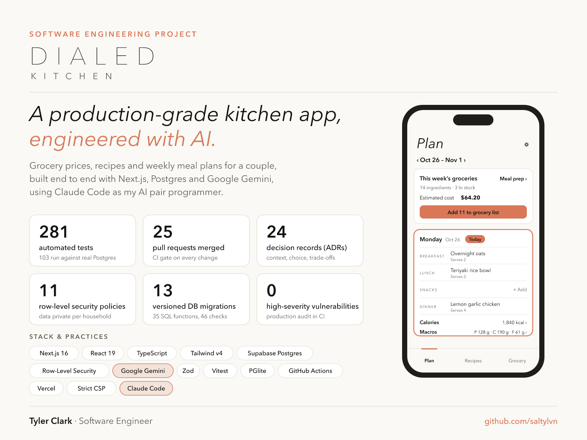

# Dialed Kitchen

[](https://github.com/saltylvn/dialed-kitchen/actions/workflows/ci.yml)
[](https://github.com/saltylvn/dialed-kitchen/security/code-scanning)


**Plan it, price it, cook it.** An iPhone-first web app (installable PWA) that a couple uses every day to plan meals, cook from recipes, track grocery prices across stores and build the shopping list, with AI that reads recipes from photos and estimates nutrition.

> **Live:** [dialed-kitchen.vercel.app](https://dialed-kitchen.vercel.app) · **Status:** in daily use; all roadmap milestones shipped.



## What it does

- **Plan:** a Monday-to-Sunday week with four spots a day (Breakfast, Lunch, Snacks, Dinner). Each spot offers only that meal's recipes. Each day shows **Calories** and **Macros** per person. **This week's groceries** adds up every ingredient (scaled to the servings planned), skips what's already in the kitchen, estimates the cost at your best prices, and adds it all to the list in one tap. **Meal prep** shows what to batch-cook and which ingredients to prep once.
- **Recipes:** grouped by meal, with favorites and "regulars" (recipes you plan often) first. Recipes come from:
  - a **website link**, read from the page's schema.org recipe data, with no AI;
  - **photos** of a cookbook, magazine or recipe card, read by Google Gemini;
  - or typing.
    Open a recipe to cook from your phone (with the screen kept awake), tick ingredients **In stock**, and add what's missing to the list. **Estimate with AI** fills in calories and macros.
- **Grocery:** one shared list with big checkboxes, an **In stock** kitchen inventory that stays in sync with recipes and the list, and a **price book**. Every price is kept as history and compared by unit price, so a 5 lb bag and a 2 lb bag compare fairly. Each item shows its best price, its **cheapest store right now**, and its **price trend**.
- **Partner sharing:** a married couple shares everything through an invite-only household (at most two people), enforced by the database.
- Food emojis next to every item and ingredient (🍗 🍚 🥚), worked out from the name.

## How it was built: AI-assisted engineering

I built Dialed Kitchen with **Claude Code** as an AI pair programmer. I owned the product and the engineering decisions:

- the features and how each screen should work, tested on my own iPhone;
- the architecture, the data model and the security model, each written up as a [decision record](docs/decisions/) with the alternatives considered;
- reviewing every change and verifying it in the browser at phone size against the live database;
- a professional delivery pipeline: a branch and pull request per change, CI that blocks merging until format, lint, type check, tests, build and a security audit all pass, versioned database migrations, and Dependabot updates tested one at a time.

Inside the product, AI is used where it earns its place, with guard rails: **Google Gemini** reads recipe photos and estimates nutrition (see [AI features](#ai-features)).

## Architecture

| Layer             | Choice                                                                                       | Why                                                                                             |
| ----------------- | -------------------------------------------------------------------------------------------- | ----------------------------------------------------------------------------------------------- |
| UI and server     | Next.js 16 (App Router), React 19 Server Components and Server Actions, TypeScript (strict)  | One codebase; data access and secrets stay on the server, and little JavaScript ships to phones |
| Styling           | Tailwind CSS v4 with named design tokens                                                     | One source of truth for colors; text contrast is checked by a test                              |
| Database and auth | Supabase: Postgres, row-level security, Google sign-in (PKCE)                                | Real relational data; the database itself enforces who can see what                             |
| AI                | Google Gemini (server-side only), structured JSON output, model fallback chain               | Reads recipe photos and estimates nutrition on the free tier                                    |
| Validation        | Zod at every trust boundary: forms, URL parameters, fetched pages, AI replies, database rows | Types aren't validation                                                                         |
| Hosting and CI    | Vercel (Node 24), GitHub Actions, Dependabot                                                 | Every push is checked; every merge to `main` deploys                                            |

**Request flow, with a check at each layer:** UI → Server Action (Zod validation and sign-in check) → server-only data access (the user's own session, never a service key) → **Postgres row-level security**, the final guard even if app code has a bug.

**Code layout:** `features/<feature>/` holds each feature's components, actions (writes), queries (reads) and schemas. `lib/` holds pure, unit-tested logic (pricing, units, nutrition, plan rules). `lib/server/` holds server-only infrastructure. `supabase/migrations/` holds versioned SQL.

### Data model

```
households ──< household_members                        household_invites (hashed, single-use, 7 days)
    │
    ├──< stores (fixed six) ──< item_prices >── items ──< grocery_list_items
    ├──< pantry_items (In stock)                  │
    └──< recipes ──< recipe_ingredients ──────────┘
            └──< meal_plan_entries
ai_requests (per-person daily AI limit)
```

Every table carries `household_id` with row-level security. Composite foreign keys (`(id, household_id)`) stop rows from pointing at another household's data. Unit price and best price are **computed from history**, never stored, so they can't go stale. The week's shopping list, its cost and the meal-prep totals come from **one SQL function**, so they always agree.

## Security

- **Strict Content Security Policy** with a per-request nonce (no inline scripts or styles in production), plus HSTS, nosniff, COOP, frame blocking and a tight Permissions-Policy.
- **Row-level security on all 12 tables**, column-level grants (the app can't set `household_id`), and `check` constraints for every invariant (46 in all).
- **Server-side auth only:** no database client in the browser; HttpOnly, SameSite, Secure cookies; Google sign-in starts from a POST with an Origin check (CSRF).
- **SSRF-safe link import:** https on port 443 only, and every resolved address is checked inside the connection's own DNS lookup, which closes DNS rebinding. Redirects are re-checked at each hop, with time, size and type limits. Sites that block apps get a clear message; nothing tries to get around them.
- **AI guard rails:** keys only on the server; every reply is validated and range-checked; prompts treat text inside photos as data; a 40-a-day per-person limit is counted atomically in Postgres (advisory lock); photos are shrunk in the browser (which strips GPS data) and never stored.
- **Code scanning:** GitHub CodeQL analyzes every push and pull request for security issues.
- **Supply chain:** a production dependency audit in CI, GitHub Actions pinned to commit SHAs, and Dependabot with written hold-back rules ([0024](docs/decisions/0024-dependency-updates.md)).

## AI features

| Feature            | How                                                                                                                                                                         |
| ------------------ | --------------------------------------------------------------------------------------------------------------------------------------------------------------------------- |
| Recipe from photos | Up to 3 photos, resized on the phone, sent to Gemini (multimodal) with a JSON schema; the answer is validated with Zod and fills an editable form; nothing saves on its own |
| Nutrition estimate | Gemini estimates per-serving calories and macros from the ingredients; any impossible value rejects the whole estimate                                                      |
| Reliability        | A chain of free models: overloaded or slow models fall through to the next, a bad key stops at once, with per-model timeouts and a total time budget                        |
| Cost control       | A shared 40-a-day limit per person, counted in Postgres                                                                                                                     |

## Quality

- **281 automated tests** (Vitest). **103 of them run against real Postgres** (PGlite, Postgres compiled to WebAssembly) with every migration applied, testing row-level security as real users: partners can share, strangers see nothing, nobody can forge or move rows.
- **CI on every pull request:** production security audit, Prettier, ESLint, TypeScript type check, all tests, and a production build.
- **Accessibility:** WCAG AA text contrast enforced by a test that reads the CSS, 48px tap targets, 17px+ text, labels on every control, and meaning never shown by color alone.
- **24 [architecture decision records](docs/decisions/)**, each with context, decision, alternatives and consequences.

## Running locally

Requires Node.js 24 and a Supabase project.

```bash
cp .env.example .env.local   # fill in the Supabase URL and publishable key (and optionally a Gemini key)
npm install
npx supabase link --project-ref <your-project-ref>
npx supabase db push         # applies the migrations in supabase/migrations
npm run dev                  # http://localhost:3000
npm test                     # unit and database tests
npm run lint && npm run typecheck && npm run build
```

## Roadmap

- [x] 0. Project setup, design tokens, CI, first deploy
- [x] 1. Google sign-in and app layout (Plan · Recipes · Grocery tabs)
- [x] 1b. Partner sharing: invite-only, for a married couple
- [x] 2. Stores, items, prices: unit price, best price, history
- [x] 3. Grocery list and shopping mode
- [x] 4. Recipes entered by hand
- [x] 4b. In stock: kitchen inventory synced with recipes and the list
- [x] 5. Recipe import from a website
- [x] 6. Recipe import from a photo
- [x] 7. Weekly meal planner
- [x] 7b. Calories and macros per day on the plan
- [x] 8. Meal plan → grocery list with estimated cost
- [x] 8b. Recipes sorted by meal (the Plan picker offers only that meal)
- [x] 9. Price trends, cheapest store, meal-prep view, app icon, food emojis

## License

Copyright © 2026 Tyler Clark. All rights reserved. The code is public to be read and evaluated; see [LICENSE](LICENSE).
